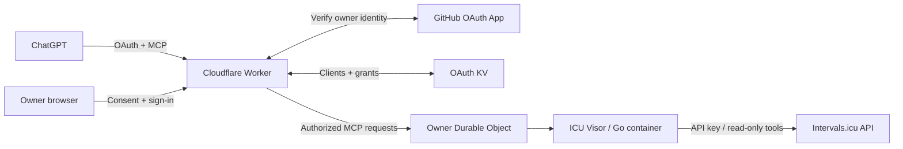

# Intervals.icu MCP · Cloudflare deployment template

[](https://github.com/lirantal/cloudflare-intervals-icu-mcp-template/actions/workflows/ci.yml)
[](https://developers.cloudflare.com/containers/)
[](#security-and-design-constraints)
[](LICENSE)

**A self-deployable Cloudflare template that connects ChatGPT to your [Intervals.icu](https://intervals.icu) training data through MCP.**

Deploy a private, single-owner gateway in your own Cloudflare account. GitHub sign-in restricts access to you; [ICU Visor](https://github.com/ricardocabral/icuvisor), the Go MCP server inside the container, provides **22 read-only tools** with the default core toolset.

**Your Cloudflare account · Your GitHub identity · Your Intervals.icu API key**

[Self-deploy](#self-deploy-on-cloudflare) · [Architecture](#architecture-at-a-glance) · [Connect ChatGPT](#connect-chatgpt) · [Documentation](#documentation)

## Architecture at a glance



| Component | Role |
| --- | --- |
| **Worker + OAuth Provider** | Public entry point; handles consent, OAuth tokens, owner checks, and MCP proxying. |
| **GitHub OAuth App** | Verifies the configured owner's numeric GitHub identity. |
| **OAuth KV** | Stores OAuth clients and authorization grants. |
| **SQLite Durable Object + Container** | Routes to one named owner instance and manages the ICU Visor container lifecycle. |
| **Intervals.icu** | Source of athlete and training data, accessed with a runtime API key. |

The Worker is the only public application ingress. It checks authorization before forwarding MCP requests; the container has no separate public endpoint. See [architecture and trust boundaries](docs/ARCHITECTURE.md) for the full flow.

## Self-deploy on Cloudflare

This repository supplies the deployment template; you provision and operate your own instance. **Workers Paid with Containers is required**, and the deployment incurs Cloudflare usage charges. Single-owner routing and idle sleep are not a spending cap.

Before starting, have:

- A Cloudflare account with Workers Paid/Containers.
- A GitHub account and a GitHub **OAuth App** for owner sign-in.
- An Intervals.icu account, athlete ID, and API key.

### Set up with a coding agent

Fork this repository, then give your coding agent this instruction:

> Inspect this repository and follow AGENTS.md's “End-to-end self-hosting setup”
> to deploy my own read-only intervals.icu MCP server to my Cloudflare account.
> Automate the implementation, checks, configuration, and deployment. Guide me
> through browser authorization, GitHub OAuth App creation, and secure secret
> entry. Confirm my account and paid provisioning before the first deployment.

The [step-by-step agent runbook](AGENTS.md#end-to-end-self-hosting-setup) covers
setup through real ChatGPT acceptance. Keep your settings in ignored
`deployment.local.json`; keep the committed template generic. Existing deployments
should use the runbook's resume path. For manual setup, follow the
[deployment guide](docs/DEPLOYMENT.md).

## Documentation

The deployment has been exercised with real GitHub OAuth, ChatGPT tool discovery,
and a user-confirmed data query. This records validation of an existing instance;
your deployment still needs its own acceptance checks. See
[validation and remaining checks](docs/VALIDATION.md).

- [Architecture, trust boundaries, and source provenance](docs/ARCHITECTURE.md)
- [Requirements, OAuth App setup, secrets, and deployment](docs/DEPLOYMENT.md)
- [Operations, rotation, rollback, costs, and acceptance checks](docs/OPERATIONS.md)
- [Troubleshooting: failures encountered and tested fixes](docs/TROUBLESHOOTING.md)
- [Validation status and its limits](docs/VALIDATION.md)
- [Security reporting and public-repository hygiene](SECURITY.md)
- [Instructions for future agents](AGENTS.md)

## Local checks

Use **Node 24.22.0** from `.node-version`, npm, Docker with Linux amd64 support, and Chromium/Chrome for the browser tests. Dependencies, `cf`, the compatible beta Vite plugin, Go, and the upstream source commit are pinned.

```sh
npm ci
npm run check:public
npm run check
REQUIRE_BROWSER_TESTS=true npm test
npm run build
npx cf deploy --prebuilt --mode production --dry-run
docker build --platform linux/amd64 -t icuvisor-mcp:test .
npm run test:container
```

Normal builds and tests use no production credentials and make no intervals.icu API calls. `cf build` builds the image but does not deploy it. The public placeholder configuration is sufficient for CI build/dry-run checks; `npm run preflight` deliberately rejects it for production.

## Configure privately

```sh
cp deployment.json deployment.local.json
chmod 600 deployment.local.json
# Edit deployment.local.json with your non-secret account/identity settings.
npm run preflight
```

`deployment.local.json` is ignored by Git and excluded from the Docker context. All commands use the same settings loader. `ICUVISOR_DEPLOYMENT_FILE` can select an explicit JSON file instead. The public `deployment.json` remains a placeholder template; never replace it with your personal deployment settings.

Create a **GitHub OAuth App**, whose callback is `PUBLIC_ORIGIN/callback`. It is distinct from a GitHub App installation and from ChatGPT's callback. Store `GITHUB_CLIENT_SECRET` and `INTERVALS_ICU_API_KEY` as Worker **Secret** entries or in an ignored mode-0600 `.dev.vars` file for first deployment. Never put them in chat, JSON settings, Docker arguments, logs, or source control.

Authenticate the official CLI with `npx cf auth login --no-browser`, verify the selected account and paid-plan requirements, and follow the [deployment guide](docs/DEPLOYMENT.md). Use `cloudflare.config.ts`; there is no maintained Wrangler configuration or separate Cloudflare Access gate.

## Connect ChatGPT

Create a custom app/connector with the URL **`PUBLIC_ORIGIN/mcp`** and authentication **OAuth**. Leave predefined client ID/secret blank when optional, allowing dynamic client registration. Review consent and sign in to the configured owner's GitHub account. Only its numeric GitHub ID can authorize access.

Use **Refresh tools**, then **Try in chat**. Ask the app to fetch your athlete profile or list a few recent activities using its tools. Verify the visible tool call and compare its result with intervals.icu. Never use a correct-looking prose answer alone as evidence of a server call. Also complete the [real non-owner denial check](docs/OPERATIONS.md#acceptance-checks).

## Security and design constraints

- Standards-based OAuth discovery, dynamic registration, explicit consent, S256 PKCE, canonical audience validation, token refresh, and authorization-version invalidation.
- `deleteMode: none` is checked before deployment and at Worker runtime; the container also hard-codes read-only registration and disables coach mode.
- Current stateless Streamable HTTP with JSON responses supports protocol `2026-07-28` and legacy initialization. A reviewed [one-line patch](patches/icuvisor-stateless-http.patch) exposes the option missing from the pinned upstream CLI; the binary version includes `+stateless-http`.
- One fixed owner Durable Object routes to a lite container with a ten-minute inactivity timeout. The account-required `durable_object` scheduling policy has no platform `max_instances` setting. Single-instance routing and idle sleep are **not a spending cap**.
- The gateway removes bearer tokens, cookies, and untrusted forwarding headers. It preserves standard MCP method/name/parameter headers required by current clients. No automatic tool-call retries occur.
- Observability is disabled; temporary development diagnostics have been removed. There is no public diagnostics endpoint or container ingress URL.
- CI checks PRs and `main`; production deployment is manually triggered from `main`. See [CI setup](docs/DEPLOYMENT.md#github-actions).

## License

Gateway code: [Apache-2.0](LICENSE), with [NOTICE](NOTICE). ICU Visor remains MIT-licensed; its [notice](patches/LICENSE.icuvisor) accompanies the source patch and is also copied into the container. Other dependencies retain their own licenses.
