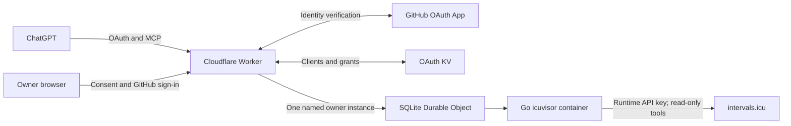

# ICU Visor MCP on Cloudflare

Run a private, single-owner [icuvisor](https://github.com/ricardocabral/icuvisor) MCP server for intervals.icu on Cloudflare. A Worker uses Cloudflare's [Workers OAuth Provider](https://github.com/cloudflare/workers-oauth-provider) to authenticate ChatGPT, identifies the owner through GitHub, and proxies authorized requests to a Go container. Training data access is **read-only**.

The deployment has been exercised with real GitHub OAuth, ChatGPT tool discovery, and a user-confirmed data query. It exposes 22 read-only tools with the default core toolset. See [validation and remaining checks](docs/VALIDATION.md).



## Getting started: self-host this template

Fork this repository, then give your coding agent this instruction:

> Inspect this repository and follow AGENTS.md's “End-to-end self-hosting setup”
> to deploy my own read-only intervals.icu MCP server to my Cloudflare account.
> Automate the implementation, checks, configuration, and deployment. Guide me
> through browser authorization, GitHub OAuth App creation, and secure secret
> entry. Confirm my account and paid provisioning before the first deployment.

The [step-by-step agent runbook](AGENTS.md#end-to-end-self-hosting-setup) covers
setup through real ChatGPT acceptance. You need a Cloudflare account with Workers
Paid/Containers, a GitHub identity and OAuth App, and an intervals.icu account/API
key. Keep your settings in ignored `deployment.local.json`; keep the committed
template generic. Existing deployments should use the runbook's resume path.

## Documentation

- [Architecture, trust boundaries, and source provenance](docs/ARCHITECTURE.md)
- [Requirements, OAuth App setup, secrets, and deployment](docs/DEPLOYMENT.md)
- [Operations, rotation, rollback, costs, and acceptance checks](docs/OPERATIONS.md)
- [Troubleshooting: failures encountered and tested fixes](docs/TROUBLESHOOTING.md)
- [Validation status and its limits](docs/VALIDATION.md)
- [Security reporting and public-repository hygiene](SECURITY.md)
- [Instructions for future agents](AGENTS.md)

## Local checks

Use **Node 24.22.0** from `.node-version`, npm, Docker with Linux amd64 support, and Chromium/Chrome for the browser tests. Dependencies, `cf`, the compatible beta Vite plugin, Go, and the upstream source commit are pinned.

```sh
npm ci
npm run check:public
npm run check
REQUIRE_BROWSER_TESTS=true npm test
npm run build
npx cf deploy --prebuilt --mode production --dry-run
docker build --platform linux/amd64 -t icuvisor-mcp:test .
npm run test:container
```

Normal builds and tests use no production credentials and make no intervals.icu API calls. `cf build` builds the image but does not deploy it. The public placeholder configuration is sufficient for CI build/dry-run checks; `npm run preflight` deliberately rejects it for production.

## Configure privately

```sh
cp deployment.json deployment.local.json
chmod 600 deployment.local.json
# Edit deployment.local.json with your non-secret account/identity settings.
npm run preflight
```

`deployment.local.json` is ignored by Git and excluded from the Docker context. All commands use the same settings loader. `ICUVISOR_DEPLOYMENT_FILE` can select an explicit JSON file instead. The public `deployment.json` remains a placeholder template; never replace it with your personal deployment settings.

Create a **GitHub OAuth App**, whose callback is `PUBLIC_ORIGIN/callback`. It is distinct from a GitHub App installation and from ChatGPT's callback. Store `GITHUB_CLIENT_SECRET` and `INTERVALS_ICU_API_KEY` as Worker **Secret** entries or in an ignored mode-0600 `.dev.vars` file for first deployment. Never put them in chat, JSON settings, Docker arguments, logs, or source control.

Authenticate the official CLI with `npx cf auth login --no-browser`, verify the selected account and paid-plan requirements, and follow the [deployment guide](docs/DEPLOYMENT.md). Use `cloudflare.config.ts`; there is no maintained Wrangler configuration or separate Cloudflare Access gate.

## Connect ChatGPT

Create a custom app/connector with the URL **`PUBLIC_ORIGIN/mcp`** and authentication **OAuth**. Leave predefined client ID/secret blank when optional, allowing dynamic client registration. Review consent and sign in to the configured owner's GitHub account. Only its numeric GitHub ID can authorize access.

Use **Refresh tools**, then **Try in chat**. Ask the app to fetch your athlete profile or list a few recent activities using its tools. Verify the visible tool call and compare its result with intervals.icu. Never use a correct-looking prose answer alone as evidence of a server call. Also complete the [real non-owner denial check](docs/OPERATIONS.md#acceptance-checks).

## Design constraints

- Standards-based OAuth discovery, dynamic registration, explicit consent, S256 PKCE, canonical audience validation, token refresh, and authorization-version invalidation.
- `deleteMode: none` is checked before deployment and at Worker runtime; the container also hard-codes read-only registration and disables coach mode.
- Current stateless Streamable HTTP with JSON responses supports protocol `2026-07-28` and legacy initialization. A reviewed [one-line patch](patches/icuvisor-stateless-http.patch) exposes the option missing from the pinned upstream CLI; the binary version includes `+stateless-http`.
- One fixed owner Durable Object routes to a lite container with a ten-minute inactivity timeout. The account-required `durable_object` scheduling policy has no platform `max_instances` setting. Single-instance routing and idle sleep are **not a spending cap**.
- The gateway removes bearer tokens, cookies, and untrusted forwarding headers. It preserves standard MCP method/name/parameter headers required by current clients. No automatic tool-call retries occur.
- Observability is disabled; temporary development diagnostics have been removed. There is no public diagnostics endpoint or container ingress URL.
- CI checks PRs and `main`; production deployment is manually triggered from `main`. See [CI setup](docs/DEPLOYMENT.md#github-actions).

## License

Gateway code: [Apache-2.0](LICENSE), with [NOTICE](NOTICE). ICU Visor remains MIT-licensed; its [notice](patches/LICENSE.icuvisor) accompanies the source patch and is also copied into the container. Other dependencies retain their own licenses.
