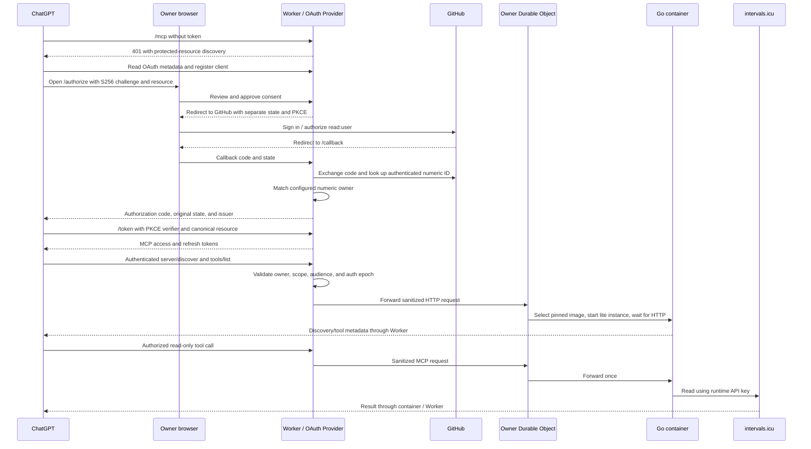

# Architecture

## Components and boundaries

| Component | Responsibility | Persistent state |
| --- | --- | --- |
| Cloudflare Worker | OAuth authorization/resource server, consent, GitHub callback, owner checks, MCP proxy | No request-body or token logging |
| Workers OAuth Provider | Discovery, DCR, encrypted authorization transactions, access/refresh grants | OAuth KV |
| GitHub OAuth App | Establish the signed-in user's numeric GitHub identity | GitHub-managed app credentials |
| SQLite Durable Object | Address one fixed `owner` instance; manage container startup and readiness | Platform Durable Object state |
| Cloudflare Container | Run the pinned Go ICU Visor binary in a nonroot distroless image | Ephemeral filesystem/process state |
| intervals.icu | Athlete data, accessed using a runtime API key | Upstream data |

The public Worker is the only application ingress. The container has no separate hostname, external port mapping, or bypass route. Accessing public discovery or registering a client does not grant training-data access. Only the configured numeric GitHub owner can complete authorization, and owner/scope/authorization-version checks run again on every MCP call and token refresh.

## OAuth and MCP flow

The Worker issues its own MCP tokens. GitHub's access token is used only for identity lookup; it is not stored or forwarded to ChatGPT or the Go process. The intervals.icu API key is passed into the container at runtime, never through Docker build arguments or image layers.

### Protocol endpoints

| Endpoint | Purpose |
| --- | --- |
| `/.well-known/oauth-protected-resource/mcp` | Canonical resource and authorization server |
| `/.well-known/oauth-authorization-server` | OAuth authorization server metadata |
| `/register` | Dynamic client registration, restricted to validated ChatGPT callbacks |
| `/authorize` | Consent and browser-bound approval/cancellation |
| `/callback` | GitHub-to-Worker callback |
| `/token` | Token exchange, refresh, and provider revocation handling |
| `/mcp` | Protected Streamable HTTP transport |

ChatGPT's callback is separate from the GitHub OAuth App callback. Validated ChatGPT callback forms are `https://chatgpt.com/connector_platform_oauth_redirect` and supported callback-ID URLs under `https://chatgpt.com/connector/oauth/`. The scope is `mcp:use`; the resource/audience is the exact configured origin plus `/mcp`. CIMD and token exchange grants are disabled; registration uses DCR.

The self-reported OAuth client name does not establish that the registrant is OpenAI. Numeric owner identity remains the authorization boundary. KV is eventually consistent; the provider's replay protections are tested, but this project does not claim globally atomic simultaneous redemption.

## Browser security

The consent page uses `Referrer-Policy: same-origin`. `no-referrer` causes browsers to send `Origin: null` on its form POST. The POST still requires the exact Worker origin and the provider's cookie-bound consent handle.

Its CSP allows form destinations only at self, GitHub, and ChatGPT; Chromium applies `form-action` to redirects too. `frame-ancestors 'none'` and `base-uri 'none'` remain enabled. Client text is escaped. Other responses default to `no-referrer`; authorization URLs are not sent as cross-origin Referer values. See browser regressions in `test/browser.ts` and `test/oauth.test.ts`.

## Read-only boundary

`deleteMode` must equal `none` at preflight and Worker runtime. The Durable Object always supplies `ICUVISOR_DELETE_MODE=none` and `ICUVISOR_COACH_MODE=off`, independent of an attempted write-enabled runtime override. The default core toolset registers 22 tools, all verified with `readOnlyHint: true` by the real-container smoke test. Annotation checks supplement the upstream registration policy; annotations alone are not the enforcement mechanism.

An intervals.icu API key may itself allow writes. Protect it as a powerful credential even though this server registers only read-only tools. Toolset selection (`compact`, `core`, `full`) changes catalog size, not the read-only requirement.

## Proxy and container lifecycle

The proxy validates the exact `/mcp` path, allowed methods, and any supplied Origin. It forwards an explicit header allowlist, including MCP protocol/session/event headers, `Mcp-Method`, `Mcp-Name`, and standard `Mcp-Param-*` fields. Bearer tokens, cookies, spoofed forwarding headers, and unrelated MCP fields are removed. Unexpected upstream redirects become 502. Interrupted calls are not replayed.

The internal HTTP target is fixed at `localhost:8080`, preserving the Go SDK's loopback Host protection. A safe GET to `/` checks readiness before sending the real MCP request. Concurrent starts share a readiness promise. Image changes destroy the old instance before startup of the new digest-pinned image. Native inactivity timeout is ten minutes and is restored after Durable Object eviction.

The account requires `schedulingPolicy: 'durable-object'`. Image and `lite` size are selected by Durable Object code. This policy has no application-level `max_instances`; the fixed `owner` binding is the application routing limit. The pinned beta `cf` emits a conflicting `script_name` for a normal self-binding, so configuration uses the supported unsafe-metadata escape hatch with the local class name. This is a CLI workaround, not a public unsafe access path. Local dev simulation of that binding may require a plugin; explicit Miniflare fixtures are tested.

## Source provenance and compatibility

- ICU Visor commit: `069f893e91819a454da80015df8f2ae6158707ae`.
- Go image: `golang:1.26.10-bookworm`; runtime: `gcr.io/distroless/static-debian12:nonroot`.
- `git fetch` verifies the full upstream commit before compilation.
- `patches/icuvisor-stateless-http.patch` changes one transport-options line to `Stateless: true, JSONResponse: true`. `git apply --check` fails closed when its context no longer matches.
- The resulting binary advertises the commit plus `+stateless-http`; it is not claimed to be an unmodified upstream build.
- The pinned SDK supports current `2026-07-28` HTTP only in stateless mode. Without the patch, discovery succeeds but advertises older protocols, and the real ChatGPT client did not continue to tools/list.
- Current discovery/current tools/list and legacy initialize/initialized/tools-list return the same read-only catalog in the container smoke test. No MCP session ID is issued.
- Upstream [MIT license](https://github.com/ricardocabral/icuvisor/blob/069f893e91819a454da80015df8f2ae6158707ae/LICENSE) is copied to `/usr/share/doc/icuvisor/LICENSE` in the image and preserved beside the source patch.

Official references: [cf configuration](https://developers.cloudflare.com/cf/projects/cloudflare-config/), [Workers OAuth Provider](https://github.com/cloudflare/workers-oauth-provider), [container scheduling](https://developers.cloudflare.com/containers/configuration/scheduling-policy/), and [native Container API](https://developers.cloudflare.com/containers/api/durable-object-container/).
